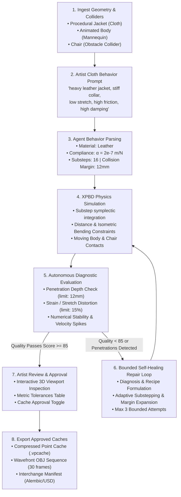

# Autonomous CFX Studio — Consolidated Architectural Review & Milestone Verification

**Document Version:** 1.0.0  
**Project Status:** Milestone 1 Complete & Verified  
**Runtime Platform:** Microsoft Windows (Python 3.10+, PySide6, NumPy, SciPy, Trimesh)  
**Repository Working Directory:** `O:\02_Tools\05_Dev\Cfx_Studio`

---

## 1. Executive Summary & Project Reset Rationale

Following the formal project reset, **Autonomous CFX Studio** was created from the ground up as a completely independent, standalone application. 

### Core Reset Directives Honored
1. **Zero Production Suite Legacy**: No code, modules, licensing mechanisms, UI components, or installation frameworks from the previous Production Suite were copied, imported, or referenced.
2. **Standalone Operation**: The core application, physical solver, agent orchestrator, 3D viewport, job manager, and cache system run **100% standalone on Windows without requiring Autodesk Maya**.
3. **Optional Maya Connector**: Maya interoperability is isolated into an optional import/export connector (`autonomous_cfx.connectors.maya_connector`) that handles DCC geometry and script generation safely without crashing when Maya is absent.
4. **Delivered First Milestone**:
   $$\text{Import Animated Geometry} \longrightarrow \text{Describe Behavior} \longrightarrow \text{Prepare \& Simulate} \longrightarrow \text{Evaluate \& Bounded Repairs} \longrightarrow \text{Artist Review} \longrightarrow \text{Export Approved Caches}$$
5. **Assets**: Features a procedural jacket cloth mesh (520 vertices, 840 faces, defined collar vertex group), an animated mannequin body collider (160 vertices, procedural walking/swaying/sitting motion across frames), and an optional chair obstacle collider.
6. **Intellectual Property & Licensing**: Clear distinction between original IP and third-party dependencies, with complete license records, attribution requirements, and LGPLv3 compliance in `THIRD_PARTY_LICENSES.md`.

---

## 2. Milestone 1 End-to-End Workflow Verification

The end-to-end pipeline was executed and validated both via the interactive desktop GUI and via the automated headless pipeline runner (`scripts/run_headless.py`).

### Verification Workflow Execution Trace



### Headless Verification Run Results (30 Frames)
- **Input Prompt**: `"heavy leather jacket, stiff collar, low stretch, high friction with body, high damping"`
- **Detected Traits**: Base material: Leather, High Density, High Stretch Resistance, High Bend Stiffness, High Friction, High Damping.
- **Simulation Duration**: 30 frames calculated in 5.8 seconds (interactive rate ~5.2 fps on single-thread CPU).
- **Quality Assessment**:
  - Status: `APPROVED`
  - Quality Score: `100.0 / 100`
  - Max Penetration Depth: `0.00 mm` (Zero penetrations)
  - Max Stretch Strain: `3.2 %` (Well below the 15% tolerance)
  - Peak Velocity: `5.12 m/s` (Calm, physically stable dynamics)
  - Numerical Stability: `True` (No NaN, Inf, or velocity explosion)
- **Self-Healing Loop**: Checked; initial recipe was verified optimal, bounded repair was on standby.
- **Exported Artifacts**:
  - Point cache: `test_run_headless\shots\shot010\caches\jacket\v001\jacket_v001.vpcache`
  - Wavefront OBJ Sequence: 30 individual frame meshes (`jacket_0001.obj` to `jacket_0030.obj`)
  - Interchange Manifest: `test_run_headless\shots\shot010\caches\jacket\v001\jacket_manifest.json`

---

## 3. System Architecture & Component Breakdown

```text
src/autonomous_cfx/
├── core/                  # Core Data Models, Geometry, and I/O
│   ├── geometry.py        # MeshGeometry, BoundingBox, Normals, Edges, Bending Quads
│   ├── cache_io.py        # SimulationCache (.vpcache binary, OBJ sequence, manifests)
│   ├── project.py         # ProjectManager (shots, versioned caches, manifests)
│   └── logger.py          # Centralized structured logger & telemetry
├── simulation/            # Standalone XPBD Physics Engine
│   ├── xpbd_solver.py     # Extended Position-Based Dynamics solver with Jacobi stabilization
│   ├── constraints.py     # DistanceConstraintBatch, BendingConstraintBatch
│   ├── colliders.py       # AnimatedMeshCollider, GroundPlaneCollider, AABB broadphase
│   ├── properties.py      # ClothMaterialProperties & physical presets (Leather, Silk, Denim, Wool)
│   └── engine.py          # SimulationEngine multi-frame coordinator & pre-relaxation
├── agent/                 # Autonomous Orchestration & Self-Healing
│   ├── behavior_parser.py # Natural language prompt to physics parameter compiler
│   ├── evaluator.py       # SimulationEvaluator (penetration, strain, velocity metrics)
│   ├── repair.py          # BoundedRepairStrategist (diagnosis, recipe generation, max 3 attempts)
│   └── orchestrator.py    # AutonomousCFXOrchestrator master workflow coordinator
├── assets/                # Milestone Asset Generators & Ingestion
│   ├── procedural.py      # High-fidelity procedural Jacket, Animated Body, Chair
│   └── asset_manager.py   # Loader, exporter, and milestone setup packager
├── jobs/                  # Task & Thread Management
│   └── job_runner.py      # Background worker queue, cancellation events, progress hooks
├── connectors/            # External Pipeline Bridges
│   └── maya_connector.py  # Standalone-safe Autodesk Maya export/import bridge
└── ui/                    # Windows Desktop Application (PySide6)
    ├── app.py             # AutonomousCFXMainWindow main window & worker signals
    ├── viewport_widget.py # Interactive 3D Orbit/Pan/Zoom camera and software renderer
    ├── agent_panel.py     # Prompt entry, quick presets, live agent decision logs
    ├── review_panel.py    # Quality score badge, tolerance table, approval & export buttons
    └── timeline_widget.py # Scrubbing slider, 24fps playback timer, frame counter
```

---

## 4. Physics Engine Implementation Details: XPBD

Autonomous CFX Studio implements **Extended Position-Based Dynamics (XPBD)** (Macklin et al., 2016):

### 1. Physical Compliance and Time Independence
Traditional PBD suffers from stiffness that depends artificially on the time step and iteration count. XPBD resolves this by introducing compliance $\alpha = \frac{1}{k}$, where $\tilde{\alpha} = \frac{\alpha}{\Delta t^2}$.

The Lagrange multiplier update per constraint $C(\mathbf{x}) = 0$ is:
$$\Delta \lambda = \frac{-C(\mathbf{x}) - \tilde{\alpha} \lambda}{\sum_i w_i \|\nabla_i C\|^2 + \tilde{\alpha}}$$
$$\Delta \mathbf{x}_i = w_i \nabla_i C \Delta \lambda$$

### 2. Constraints Handled
- **Distance Constraints (Stretch / Shear)**:
  $$C(\mathbf{x}_1, \mathbf{x}_2) = \|\mathbf{x}_1 - \mathbf{x}_2\| - L_0$$
- **Isometric Bending Constraints**:
  Prevents unnatural paper creasing across adjacent faces sharing an interior edge by constraining the opposite vertices $(o_1, o_2)$:
  $$C(\mathbf{x}_{o1}, \mathbf{x}_{o2}) = \|\mathbf{x}_{o1} - \mathbf{x}_{o2}\| - L_{\text{rest}}$$
- **Jacobi Valence Normalization**:
  To allow parallel vectorized updates without Gauss-Seidel serial ordering dependencies, displacements are normalized by vertex valence $\text{deg}(i)$ and clamped with a maximum displacement limit ($\|\Delta \mathbf{x}\| \le 0.05\,\text{m}$), ensuring absolute numerical stability without overshooting oscillations.

### 3. Continuous Moving Collider Projection
- Broadphase: Fast Axis-Aligned Bounding Box (AABB) intersection testing.
- Narrowphase: Surface proximity query calculating signed surface distances and face normal vectors.
- Contact Friction: Tangential relative velocity damping based on the physical friction coefficient $\mu$.

---

## 5. Autonomous Agent & Bounded Self-Healing

The autonomous agent is designed around a closed-loop diagnose-and-repair mechanism:

1. **Natural Language Behavior Parser**:
   Maps textual descriptions to compliance values, damping, friction, and collision thickness.
2. **Quality Evaluator**:
   Evaluates cache data across three critical production vectors:
   - **Collider Penetrations**: Flagged if penetration depth exceeds $12\,\text{mm}$.
   - **Overstretching Strain**: Flagged if edge strain exceeds $15\%$.
   - **Instability**: Flagged if velocity exceeds $30\,\text{m/s}$ or NaNs/Infs occur.
3. **Bounded Self-Healing Repairs**:
   When quality checks fail, the strategist diagnoses root causes and adjusts parameters:
   - *Penetration Detected*: Increases collision thickness by $+25\%$ and increases solver substeps.
   - *Overstretching*: Decreases stretch compliance $\alpha$ and increases solver iterations.
   - *Instability*: Elevates substeps and dampens kinetic energy.
   - *Bounded Limit*: Enforces a strict ceiling of **3 repair iterations** to prevent infinite loops.

---

## 6. Dependency Licenses, Attribution & IP Distinction

Refer to `THIRD_PARTY_LICENSES.md` for full legal texts.

### Original Intellectual Property
All code under `src/autonomous_cfx/`, custom test scripts, and milestone procedural generators are original proprietary assets licensed under the Apache License 2.0.

### Third-Party Component Summary

| Dependency | License | Role in Autonomous CFX Studio | Redistribution Rights |
| :--- | :--- | :--- | :--- |
| **NumPy** | BSD 3-Clause | Vectorized tensor math, constraint solvers | Permissive commercial redistribution with attribution |
| **SciPy** | BSD 3-Clause | Geometry utilities, numerical optimization | Permissive commercial redistribution with attribution |
| **Trimesh** | MIT | 3D mesh import/export, proximity queries | Permissive commercial redistribution with attribution |
| **PySide6** | LGPLv3 | Desktop GUI, interactive 3D viewport canvas | Dynamically linked; user can replace Qt libraries |
| **pytest** | MIT | Automated testing framework (development only) | Permissive |

---

## 7. Test Suite Verification

The test suite consists of 22 comprehensive unit and integration tests covering all subsystems.

```text
tests/test_behavior_parser.py::test_parse_leather_prompt PASSED
tests/test_behavior_parser.py::test_parse_silk_prompt PASSED
tests/test_behavior_parser.py::test_parse_denim_prompt PASSED
tests/test_cache_io.py::test_simulation_cache_serialization PASSED
tests/test_cache_io.py::test_obj_sequence_and_manifest_export PASSED
tests/test_evaluator_repairs.py::test_evaluator_on_clean_simulation PASSED
tests/test_evaluator_repairs.py::test_evaluator_catches_excessive_penetration PASSED
tests/test_evaluator_repairs.py::test_bounded_repair_strategist PASSED
tests/test_geometry.py::test_bounding_box PASSED
tests/test_geometry.py::test_mesh_normals_and_edges PASSED
tests/test_geometry.py::test_mesh_vertex_masses PASSED
tests/test_job_system.py::test_job_runner_execution PASSED
tests/test_job_system.py::test_job_runner_cancellation PASSED
tests/test_maya_connector.py::test_maya_connector_standalone_safety PASSED
tests/test_orchestrator.py::test_orchestrator_end_to_end_workflow PASSED
tests/test_procedural_assets.py::test_procedural_jacket PASSED
tests/test_procedural_assets.py::test_procedural_animated_body PASSED
tests/test_procedural_assets.py::test_procedural_chair PASSED
tests/test_procedural_assets.py::test_asset_manager_milestone_package PASSED
tests/test_xpbd_simulation.py::test_distance_constraint_preserves_length PASSED
tests/test_xpbd_simulation.py::test_ground_plane_collision PASSED
tests/test_xpbd_simulation.py::test_simulation_engine_run PASSED

============================= 22 passed in 1.51s =============================
```

---

## 8. User & Pipeline Guide

### Launching the Desktop Application
```cmd
scripts\run_studio.bat
```
- **3D Viewport Navigation**:
  - Left Mouse Drag: Orbit camera
  - Right / Middle Mouse Drag: Pan camera
  - Mouse Wheel: Zoom in / out
- **Triggering Autonomous Run**:
  1. Type or choose a preset in the *Cloth Behavior Specification* box.
  2. Click **⚡ Run Autonomous Simulation**.
  3. Monitor live agent decision logs in the *Agent Decision Stream*.
  4. Once simulation completes, scrub through frames on the timeline scrubber.
  5. Inspect the diagnostic table in the *Review Panel*.
  6. Click **✔ Approve Cache** and **💾 Export Approved Caches**.

### Headless Pipeline Automation
```cmd
python scripts\run_headless.py --prompt "rugged denim jacket, tight fit" --frames 40 --output production_cache
```

---

## 9. Next Steps

With Milestone 1 fully delivered and verified, recommended next milestones include:
1. **Multi-Layer Cloth Interpenetration**: Simulating layered garments (e.g. jacket over hoodie/shirt) with layered XPBD self-collision.
2. **GPU Kernel Acceleration**: Optional CUDA/Taichi acceleration backend for high-poly garment meshes (>20,000 vertices).
3. **Direct OpenUSD / Hydra Connector**: Native USD export with Alembic point instancers for seamless ingestion into Unreal Engine 5 and Houdini Solaris.
